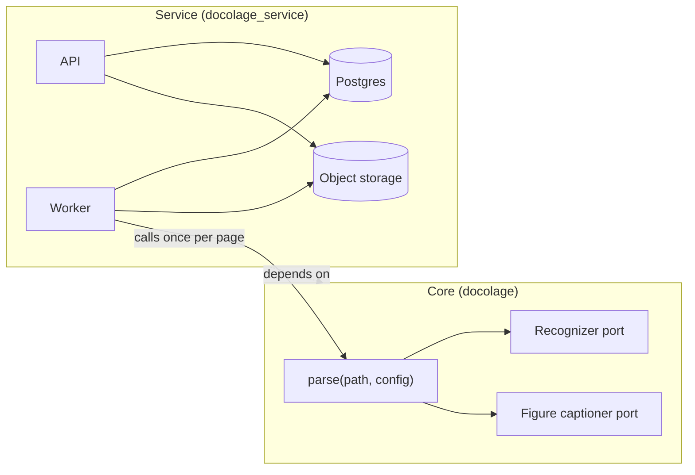
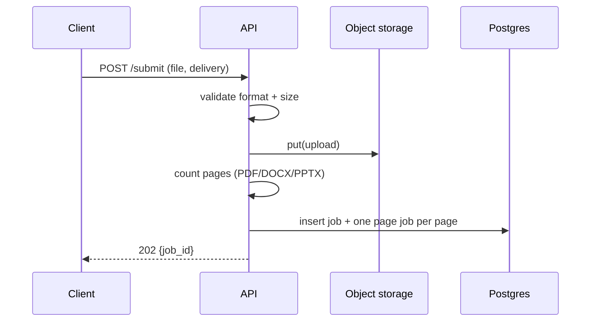
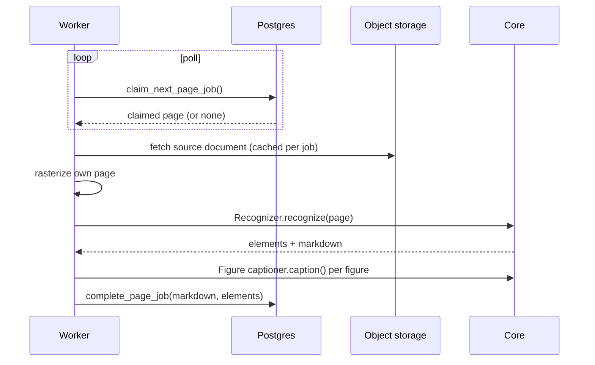
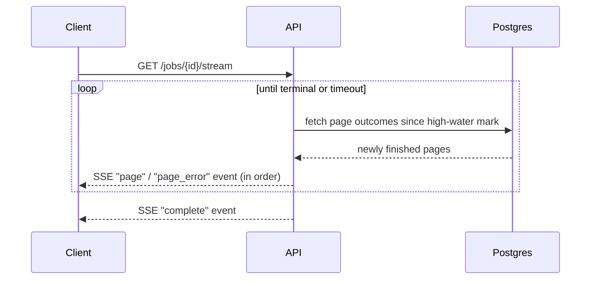
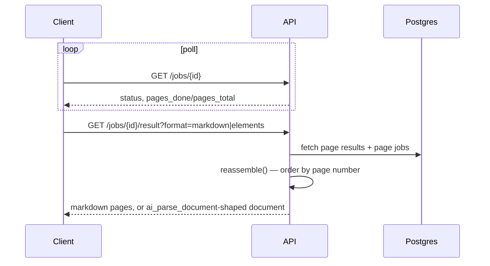

# Architecture

This is the visual companion to [CONTEXT.md](../CONTEXT.md) (terminology)
and [docs/spec/0002](spec/0002-docolage-service-off-databricks.md) (the
current spec). Each diagram below covers one concern in isolation rather
than one diagram trying to show the whole system at once — cross-reference
the linked ADRs for the *why* behind each decision; this doc only shows
the *shape*.

## 1. Core vs Service boundary

The Core (`docolage.parse()` and everything under it) is pure Python with
no knowledge of queues, HTTP, or Databricks. The Service is a deployable
shell that calls the Core once per page. The dependency arrow points one
way only — the Core must never import queue, API, or storage code — so a
plain `pip install ai-docolage` never pulls in FastAPI, asyncpg, or boto3
(spec "Package boundary").



Two real implementations plug into the two Core ports: `DoclingRecognizer`
(ADR-0010, docling's standard pipeline — layout model, TableFormer, OCR
only where needed) and `OpenAICaptioner` (the External OpenAI API,
unconditional captioning per ADR-0010). Both ports also have a fake for
testing the Core without a GPU or network (spec "The seam").

The Recognizer port actually resolves to `FallbackRecognizer` (ADR-0012):
it calls `DoclingRecognizer` first, and only escalates to a second
implementation, `OpenAIRecognizer`, when docling's own page-level
confidence falls below a configured threshold — the page-level
counterpart to Figure captioning's per-figure OpenAI dependency, silently
absent under the same condition (no `OPENAI_API_KEY`).

## 2. Submit → Async flow

A client POSTs a document and gets a job id back immediately — no
rasterization happens at submit time; a Worker rasterizes its own page
later (spec "API contract", ADR-0009 "the page is the unit of work"). This
is what makes submit fast even for a large async upload.



Sync submissions get a higher queue priority than async ones
(`SYNC_PRIORITY` vs `ASYNC_PRIORITY` in `db/queries.py`), so a large async
document can never make a waiting Sync client queue behind it (spec user
story 40). A Sync submission above the **Sync gate** page-count threshold
is refused here with an actionable error instead of being queued.

## 3. Worker claim/process loop

Each Worker repeatedly claims the single highest-priority, oldest Page
job with one atomic SQL statement (`FOR UPDATE SKIP LOCKED`), so two
Workers can never claim the same page. It then rasterizes only its own
page, runs it through the Core's Recognizer and Figure captioner ports,
and writes the result back.



A page that fails is retried up to `page_job_max_attempts`, then marked
permanently `failed` (spec user stories 53–56); a claim whose lease
expires becomes claimable again, recovering a crashed Worker's page
(spec "Storage and queue"). The parent job's status
(`completed`/`partial`/`failed`) is derived from its page jobs once every
page reaches a terminal state (`jobs/status.py`).

## 4. Sync (SSE) delivery

Rather than LISTEN/NOTIFY or a broker, the Sync stream polls the
page-results table on a short interval and emits newly-completed pages in
page order, tracking a per-stream high-water mark (ADR-0008). Postgres
stays the single source of truth throughout.



A page that finishes out of order is withheld until the gap in front of
it closes (`jobs/stream_ordering.py`), so the client never has to
reorder. Client disconnect does not cancel the job — polling stops, the
job keeps running, and the same job id is retrievable through the Async
endpoints (spec user stories 29–30).

## 5. Async polling + reassembly

The Async path is the same underlying job, viewed by polling instead of
streaming: a client checks status until the job reaches a terminal state,
then fetches the result in either representation.



`reassemble()` (`jobs/reassembly.py`) is pure — no database access — and
does only page-number ordering, with no cross-page reconciliation
(ADR-0009 accepts this as the MVP's known quality risk: a table split
across a page break, or heading hierarchy spanning pages, is not
resolved). A job with at least one successful and one permanently-failed
page reassembles as `partial`, carrying both the successful pages and an
`error_status` entry per failure (spec user stories 56–58).

## 6. Job management: cancel, retry, list

Beyond submit/status/result, three endpoints give operators control over
the queue without touching Postgres directly — added because a stuck or
unwanted job previously had no way to be stopped, and a `failed`/`partial`
job could only be recovered by re-uploading the whole document.

```mermaid
sequenceDiagram
    participant Client
    participant API
    participant Postgres

    Client->>API: POST /jobs/{id}/cancel
    API->>Postgres: jobs.status='cancelled';<br/>page_jobs.status='cancelled'<br/>WHERE status IN ('queued','claimed')
    API-->>Client: job status (idempotent no-op if already terminal)

    Client->>API: POST /jobs/{id}/retry
    API->>Postgres: reset 'failed' page_jobs to 'queued'<br/>(fresh attempt_count); jobs.status='queued'
    API-->>Client: 409 unless job was failed/partial

    Client->>API: GET /jobs?status=&stale=&limit=&offset=
    API->>Postgres: filter by status, or by<br/>running + stale updated_at
    API-->>Client: job summaries, newest first
```

**Cancel** only stops *future* claiming — a page a Worker already claimed
keeps running to completion, since there's no per-job cancellation signal
to an in-flight Worker (claiming is purely SQL-state-driven, see §3). A
page that finishes after its job was cancelled still writes its result,
but `_finalize_job_if_terminal`'s guard excludes `cancelled` from being
overwritten, so the job's status itself stays `cancelled`.

**Retry** is only valid on a `failed` or `partial` job (i.e. `derive_job_status`
found at least one permanently-failed page, `jobs/status.py`) — anything
else is a `409`. It resets exactly the permanently-`failed` page_jobs back
to `queued` with a fresh attempt budget, leaving already-`succeeded` pages
untouched, then flips the job back to `queued` so the existing claim query
and `mark_job_running_if_needed` pick it up with no Worker-side changes.

**List** (`GET /jobs`) is read-only and supports `?stale=true` to surface
`running` jobs whose `updated_at` hasn't moved within the configured
`job_stall_timeout_seconds` — the same predicate `fail_stalled_jobs` uses
to auto-fail a stuck job, exposed here as a non-mutating query for
spotting queue problems before they self-resolve.

Schema note: `cancelled` was added to both `jobs.status` and
`page_jobs.status`'s CHECK constraints in
`db/migrations/0003_job_cancel.sql`.

## 7. Observability and operational hardening

Added to close the gap between "the queue mechanics are correct" and "an
operator can tell what's happening without reading Postgres by hand."

**Logging.** Both the API and the Worker call
`docolage_service.logging_config.configure_logging(service_name)` at
import time, replacing the previous plain-text `logging.basicConfig`.
Output is JSON-to-stdout with a `service` field (`"api"`/`"worker"`) —
portable to any log platform (Datadog agent, Loki, a self-hosted sink) via
the deploy-time log driver, with no further application change needed. A
job's `job_id` is attached via `extra={"job_id": ...}` at the points that
matter — submit (`api/routes/jobs.py`), claim/succeed/fail
(`worker/main.py`) — so one job's lifecycle can be grepped across both
processes' logs by that one field.

**Metrics.** `docolage_service/metrics.py` defines Prometheus metrics
shared by both processes: `docolage_jobs_submitted_total{delivery}`,
`docolage_page_jobs_total{result}`, `docolage_page_processing_seconds`
(histogram), `docolage_openai_fallback_total`, and
`docolage_queue_depth` (gauge, sampled each Worker idle poll via
`queries.count_queued_page_jobs`). The API exposes them at `GET /metrics`;
each Worker process exposes its own at `GET :9100/metrics`
(`prometheus_client.start_http_server`, port from
`Settings.worker_metrics_port`) since the Worker isn't otherwise an HTTP
service. On today's single-host docker-compose deployment (no
autoscaler), the payoff is visibility — queue depth, per-page latency,
OpenAI-fallback rate, and error rate were previously only inspectable by
manually polling `GET /jobs?stale=true`.

**Per-page timeout.** `Settings.page_processing_timeout_seconds`
(default 120s, `docolage.yaml`'s `queue` section) bounds one page's
rasterize+recognize+caption call
(`worker/main.py::claim_and_process_one`'s `_process`), wrapped via
`asyncio.wait_for`. `_process` makes no DB writes — persistence happens
only after it returns — so a timeout can't corrupt partial state; it
flows into the same retry path (`fail_page_job`) as any other page
failure. Caveat worth knowing operationally: `asyncio.wait_for` cancels
the *awaiting* coroutine, not the underlying OS thread — a genuinely
hung docling call keeps running in the thread pool until it finishes on
its own. The timeout bounds queue-visible staleness (the page is
retried/failed promptly), not the underlying compute.

**Rate limiting.** `POST /submit` is limited to 10 requests/minute per
client IP (`slowapi`, `docolage_service/api/rate_limit.py`'s shared
`Limiter`), returning `429` past the threshold — the only previous guard
was `max_upload_bytes` per request, with no cap on request *rate*.

**Retention.** `result_retention_days` (`docolage.yaml`'s `result`
section) defaults to 365. It is intentionally still unenforced — no purge
job exists — since building real retention (periodic delete plus object
storage blob cleanup, which `queries.py` has no reference to today) is
separate-scope work; the value only documents intent for now.

**Credentials.** `docker-compose.yml`'s Postgres/MinIO credentials are
sourced from environment variables (`${POSTGRES_PASSWORD:-docolage}`
etc.) with harmless local-dev fallbacks, rather than hardcoded literals.
Copy `.env.example` to `.env` and fill in real values for anything beyond
local dev; `.env` itself stays gitignored.

**CI.** `.github/workflows/ci.yml` runs `ruff check src`, `mypy src`, and
the default `pytest` suite (`-m "not gpu and not service and not
docling"`, no external services needed) on every push/PR to `main`.
