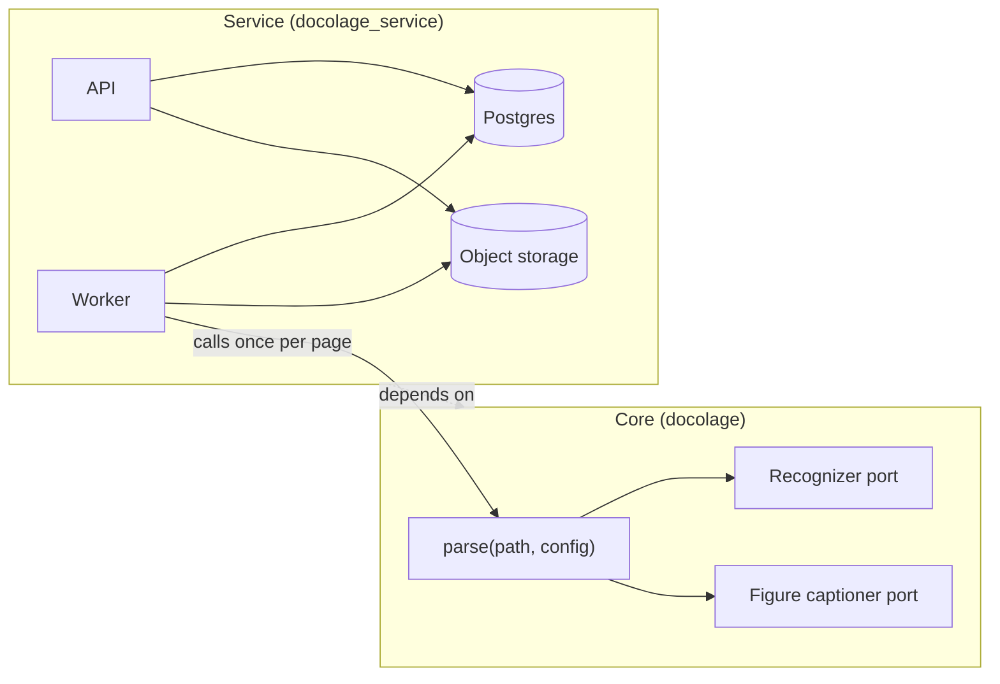
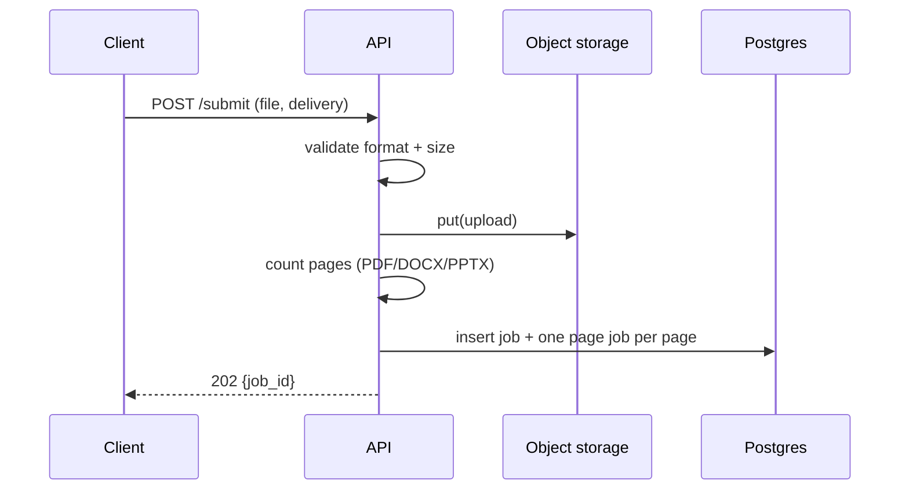
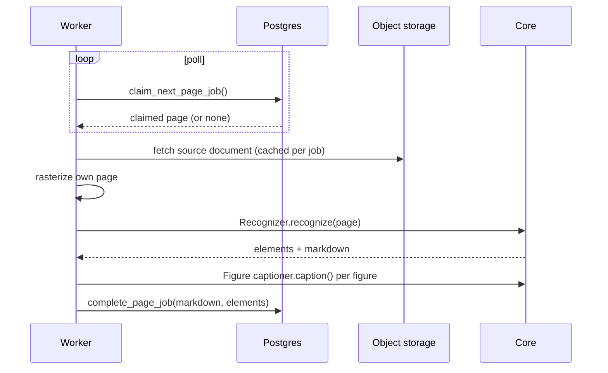
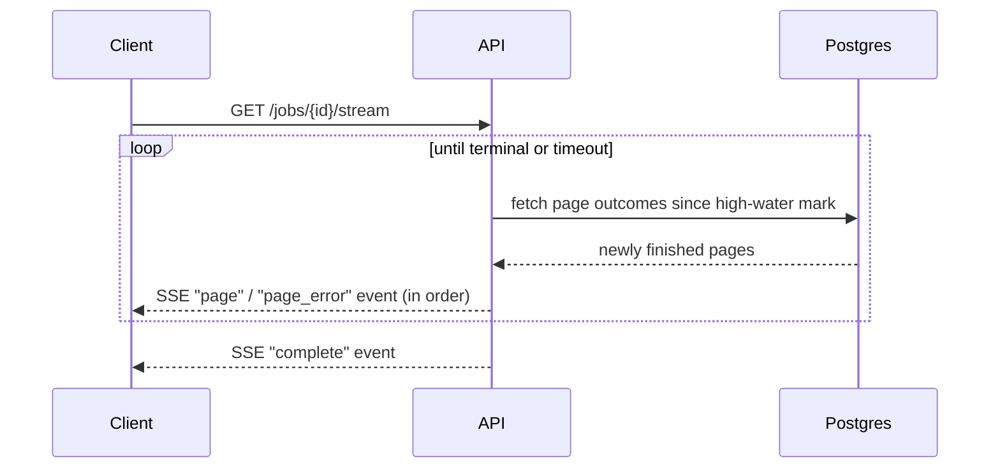
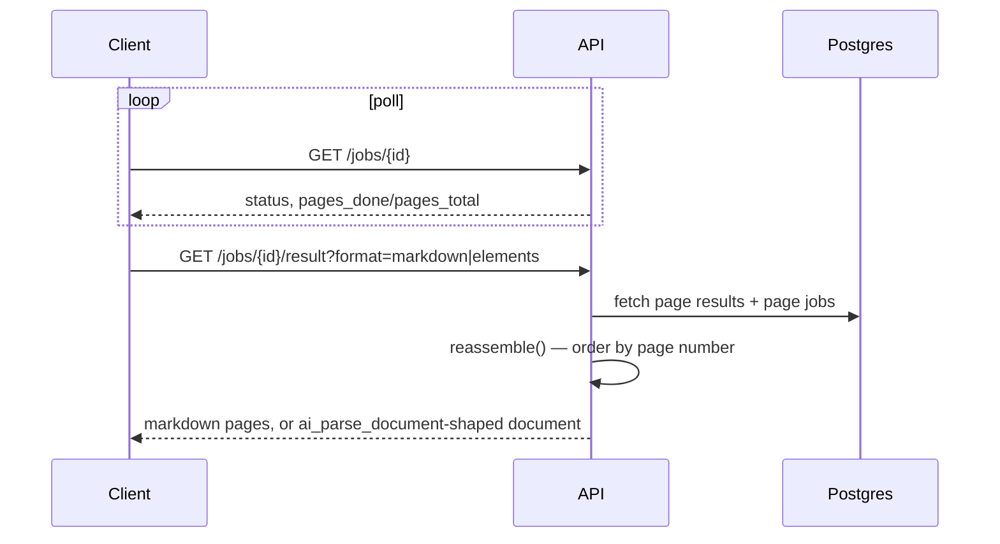

# Architecture

This is the visual companion to [CONTEXT.md](../CONTEXT.md) (terminology)
and [docs/spec/0002](spec/0002-docolage-service-off-databricks.md) (the
current spec). Each diagram below covers one concern in isolation rather
than one diagram trying to show the whole system at once — cross-reference
the linked ADRs for the *why* behind each decision; this doc only shows
the *shape*.

## 1. Core vs Service boundary

The Core (`docolage.parse()` and everything under it) is pure Python with
no knowledge of queues, HTTP, or Databricks. The Service is a deployable
shell that calls the Core once per page. The dependency arrow points one
way only — the Core must never import queue, API, or storage code — so a
plain `pip install ai-docolage` never pulls in FastAPI, asyncpg, or boto3
(spec "Package boundary").

Two real implementations plug into the two Core ports: `DoclingRecognizer`
(ADR-0010, docling's standard pipeline — layout model, TableFormer, OCR
only where needed) and `OpenAICaptioner` (the External OpenAI API,
unconditional captioning per ADR-0010). Both ports also have a fake for
testing the Core without a GPU or network (spec "The seam").

The Recognizer port actually resolves to `FallbackRecognizer` (ADR-0012):
it calls `DoclingRecognizer` first, and only escalates to a second
implementation, `OpenAIRecognizer`, when docling's own page-level
confidence falls below a configured threshold — the page-level
counterpart to Figure captioning's per-figure OpenAI dependency, silently
absent under the same condition (no `OPENAI_API_KEY`).

## 2. Submit → Async flow

A client POSTs a document and gets a job id back immediately — no
rasterization happens at submit time; a Worker rasterizes its own page
later (spec "API contract", ADR-0009 "the page is the unit of work"). This
is what makes submit fast even for a large async upload.

Sync submissions get a higher queue priority than async ones
(`SYNC_PRIORITY` vs `ASYNC_PRIORITY` in `db/queries.py`), so a large async
document can never make a waiting Sync client queue behind it (spec user
story 40). A Sync submission above the **Sync gate** page-count threshold
is refused here with an actionable error instead of being queued.

## 3. Worker claim/process loop

Each Worker repeatedly claims the single highest-priority, oldest Page
job with one atomic SQL statement (`FOR UPDATE SKIP LOCKED`), so two
Workers can never claim the same page. It then rasterizes only its own
page, runs it through the Core's Recognizer and Figure captioner ports,
and writes the result back.

A page that fails is retried up to `page_job_max_attempts`, then marked
permanently `failed` (spec user stories 53–56); a claim whose lease
expires becomes claimable again, recovering a crashed Worker's page
(spec "Storage and queue"). The parent job's status
(`completed`/`partial`/`failed`) is derived from its page jobs once every
page reaches a terminal state (`jobs/status.py`).

## 4. Sync (SSE) delivery

Rather than LISTEN/NOTIFY or a broker, the Sync stream polls the
page-results table on a short interval and emits newly-completed pages in
page order, tracking a per-stream high-water mark (ADR-0008). Postgres
stays the single source of truth throughout.

A page that finishes out of order is withheld until the gap in front of
it closes (`jobs/stream_ordering.py`), so the client never has to
reorder. Client disconnect does not cancel the job — polling stops, the
job keeps running, and the same job id is retrievable through the Async
endpoints (spec user stories 29–30).

## 5. Async polling + reassembly

The Async path is the same underlying job, viewed by polling instead of
streaming: a client checks status until the job reaches a terminal state,
then fetches the result in either representation.

`reassemble()` (`jobs/reassembly.py`) is pure — no database access — and
does only page-number ordering, with no cross-page reconciliation
(ADR-0009 accepts this as the MVP's known quality risk: a table split
across a page break, or heading hierarchy spanning pages, is not
resolved). A job with at least one successful and one permanently-failed
page reassembles as `partial`, carrying both the successful pages and an
`error_status` entry per failure (spec user stories 56–58).
